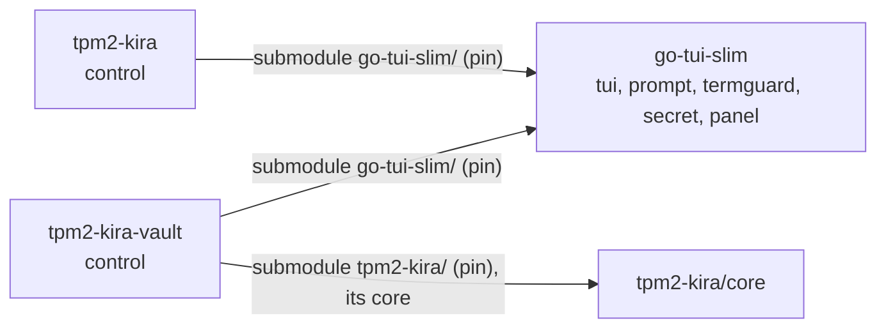

# PLAN: `tpm2-kira-vault control`

Status: proposed, waiting for the owner's word. No code before it.

## Goal

A guided control panel for the vault server, in the spirit of `tpm2-kira control`:
one full screen (sections, steps marked done/open/blocked/dirty, the detail, the
command each step equals, search), line menus with `--lines`, a plain printout
without a terminal. It takes a person from an empty host to a serving vault with
machines enrolled, and then runs the day-to-day work: the queue, devices,
operators, reseal. Everything it does stays doable by hand; the panel adds no
capability of its own except the few admin endpoints and checks listed below.

## What setting up a vault takes today (and where it goes wrong)

| # | Step | Command | Checks now | Where people go wrong |
|---|---|---|---|---|
| 1 | install | `make build && make install` | - | the unit's `ConditionPathExists=config.json`: enabled before `init`, it is silently skipped |
| 2 | create | `init --url --listen --pcrs --tpm --admin-socket --operator-listen` | TPM seals and unseals; URL is https with a host; operator-listen not the listen address | the leaf is made for the URL's host alone (DNS name or IP SAN): machines that reach the vault by another name or address fail TLS, and URL/listen cannot be changed after init (only a new vault); `--pcrs ""` (warned); `--tpm` a swtpm socket = keys bound to nothing (not said); `--tpm` other than `/dev/tpmrm0` or `--admin-socket` outside `/run/tpm2-kira-vault` break under the unit (`DeviceAllow`, `ProtectSystem=strict`) |
| 3 | recovery key | printed once by init | - | not written down; never verified until a reseal needs it |
| 4 | run | `systemctl enable --now tpm2-kira-vault` | - | TCP 8443 not opened; 8444 opened to the world instead of operators only |
| 5 | root to machines | `tls root > vault-ca.pem` | - | copied without the pin; the pin comes with the token |
| 6 | per machine | `token create --name [--mode] [--ttl 1h] [--replace]` | name; mode | token expires in 1 h, works once; expired tokens stay in `tokens/` and are not listable; `--replace` forgotten for a re-enrolment |
| 7 | the machine's side | `tpm2-kira control` → Disk unlock → vault, or `luks enrol … --url --pin --token --ca` | tpm2-kira's | the boot image without network; Secure Boot not on (the vault releases nothing) |
| 8 | operators | `config set operator-listen` (serve stopped), `operator add NAME` | lock held → refused | done while serve runs (ErrLocked); the bearer token shown once |
| 9 | daily | `requests answer`, `request approve|deny`, `device revoke|unrevoke|unlock|mode`, `audit` | pepper required for pepper devices | a request expires after 15 min (`PendingTTL`); a device locks after 5 failures (`MaxFailures`) |
| 10 | vault firmware/SB change | `systemctl stop; reseal [--pcrs]; systemctl start` | recovery key's public half | nothing tells the person that a reseal is due: releases just fail |

Pending requests and keyboard layouts live only in serve's memory; config,
devices, tokens and operators are files under `/var/lib/tpm2-kira-vault`
(`init`, `config`, `reseal` need the directory lock that serve holds).

## Structural problem: the UI code is tpm2-kira's `internal/`

`internal/tui` (text, terminal, keys, frames, Hush) and `internal/prompt`
(menus, lines, yes/no, secret lines) are generic, but internal to tpm2-kira:
Go forbids importing them from the vault, and the vault may depend on
tpm2-kira's core alone. Their dependencies inside tpm2-kira:

- `tui/term.go` → `internal/termguard` (generic; also used by `internal/signing/pin.go`)
- `prompt/prompt.go` → `internal/termguard`, `internal/wipe` (8 lines), and
  `internal/diskkey` for `PassphraseBuffer()` (an mlocked 512-byte buffer that
  narrates a failed lock to the journal) and `MaxPassphrase`
- `prompt/menu.go` → `internal/tui`
- The screen itself (`internal/admin/control_screen.go`, 687 lines: `screenState`,
  frame, sidebar, detail, search, status row, keys) is generic in substance but
  typed on tpm2-kira's `controlStep`/`controller`.

Options:

| | Option | Verdict |
|---|---|---|
| A | **A workspace module of its own**, like go-uefi-slim: `github.com/tpm2-trust/go-tui-slim` (name open), stdlib and x/sys alone: `tui`, `prompt`, `termguard`, `secret` (wipe, locked buffer), and `panel` (the screen model extracted from control_screen.go) | **recommended**: matches "what both need goes into a package neither owns, with a pin" |
| B | Move them into `tpm2-kira/core` | rejected: the core is the protocol of phone, vault and tpm2-kira; a UI there makes every UI change a protocol change for all three (their test runs) and drags it into Marify's gomobile module graph |
| C | Copy into the vault | forbidden by the workspace rules ("never a copy in a project") |
| D | Vault writes its own small screen on raw x/sys | allowed, but it is option C in slow motion: the same frame/keys/prompt logic twice, diverging |
| E | Into aSSH | rejected: aSSH is TPM/SSH/EFI/confinement; a terminal UI is none of them |

What A needs:

- **Moving prompt off diskkey:** `Prompter` gets `SecretBuffer func() []byte`
  (default `secret.LockedBuffer(prompt.MaxSecret)`: mlock, no logging) and
  `MaxSecret = 512`. tpm2-kira sets `p.SecretBuffer = diskkey.PassphraseBuffer`
  in its one `prompt.New` wrapper, so its locked 512-byte buffer and the journal
  line stay exactly as now. `termguard` moves whole; tpm2-kira's `signing/pin.go`
  imports it from the module. `wipe`: the module has `secret.Wipe`; tpm2-kira's
  `internal/wipe` stays (other users) or switches - open question 3.
- **Pins:** the module is a submodule in each consumer, like go-uefi-slim:
  `tpm2-kira/go-tui-slim` and `tpm2-kira-vault/go-tui-slim`, `replace
  ./go-tui-slim` in each go.mod. (Not nested through the vault's
  `tpm2-kira/`: the vault's UI must not move with the core pin.)
- **`pin`:** two lines in `SUBMODULES` (`"tpm2-kira go-tui-slim go-tui-slim"`,
  `"tpm2-kira-vault go-tui-slim go-tui-slim"`), `go-tui-slim) pin_submodules
  go-tui-slim ;;` and its usage line, `go-tui-slim` in the dirty-checkout loop
  of `status`; `AUR_PINS` gets `"_tuislim go-tui-slim"` (GitHub tarballs leave
  submodules out). `nested()` already handles the vault's `tpm2-kira/go-tui-slim`.
- **go.work:** `use ./go-tui-slim`, `replace github.com/tpm2-trust/go-tui-slim
  v0.0.0 => ./go-tui-slim`.
- **Workspace AGENTS.md:** a row in "The projects", in the consumer table, the
  diagram, and in "What to test" (`go-tui-slim/`: its tests; tpm2-kira's
  `make test-all` and the vault's tests after `./pin go-tui-slim`);
  `tools/test-affected.py` learns it.
- **Release builds:** tpm2-kira's PKGBUILD/debian/rules and the vault's
  `make build` already use `GOWORK=off` and the submodules; the AUR recipe needs
  `_tuislim`.

## The panel

`tpm2-kira-vault control [--dir DIR] [--socket PATH] [--lines] [--debug]`, root
only. Facts in two passes, as in tpm2-kira: fast (files, config, unit state:
`systemctl show -p LoadState,UnitFileState,ActiveState,ExecStart
tpm2-kira-vault`), then slow in the background ("checking"): the admin socket's
status, a TLS handshake to each listen address verified against the root and
the pin (`tlsutil.ClientConfig`, SNI = the URL's host), the URL host's DNS.
The panel never opens the TPM itself (a swtpm socket takes one client; serve has
it) and never calls `tlsutil.Load` (it renews and writes); it reads `cert.pem`
and `ca.pem`.

| Section | Lines (judged: green / orange / red with the risk) and steps | Equals |
|---|---|---|
| Overview | root; state dir 0700; TPM: hardware or a socket (red: "a software TPM: the device keys are as safe as this directory"), manufacturer (from serve); PCRs (empty red); seal check (red: "reseal due"); URL host = leaf's name, resolves, a local address (orange when not: NAT); leaf and root validity; machines' port answers, verified; operator port on/off, on all addresses (orange); admin socket 0600 root, answers; unit installed/enabled/active, its `--dir` and the config's TPM and socket fit the unit (red otherwise); devices: count, any locked/revoked/Secure Boot not on; unused and expired tokens; pending requests (the recommended step) | `systemctl status`, `devices`, `requests` |
| Setup | **Create the vault** (guided init: URL proposed from hostname and addresses, its cert-name consequence said; listen; PCRs with the reseal consequence; TPM detected, a socket warned; operator interface yes/no); **check the recovery key** (new, below); **the service** (enable --now; firewall advice for 8443/8444, never edited) | `init …`; `recovery check`; `systemctl enable --now tpm2-kira-vault` |
| Machines | **Enrol a machine** (name, mode, ttl, replace: token create; shows the token once, URL, pin, the line for `tpm2-kira control`'s vault step and `luks enrol`; offers to write the root to a file); **unused tokens** (each a line: withdraw ⚠); **each device** a line: show, mode, unlock, revoke/unrevoke | `token create …`; `token withdraw ID`; `device …` |
| Requests | each pending request a line: approve (pepper asked where needed) / deny; a released keyboard request: **show its layout** (on Enter only, never in the detail pane) | `request approve|deny ID` |
| Operators | interface on/off (stops and starts the unit, asked); add (token once); each operator a line: remove ⚠ (typed name) | `config set operator-listen`; `operator add|remove` |
| Maintenance | **Reseal** (stops the unit, asks the recovery key, starts it); show root and pin | `systemctl stop …; reseal; systemctl start …`; `tls root` |
| Tools | `devices`, `requests`, `operators`, `audit`, `audit --follow`, `tls root`, `token list` run as they are | the same |
| Reference | `help` | `help` |

Danger: view / change / destroy as in tpm2-kira. Destroying (typed word):
operator remove (its name), token withdraw (`withdraw`). Revoke is a change
(reversible), asked y/N. A new vault over an existing one is not offered
(`rm -r` of the state directory by hand, with what it costs said in Reference).

**Secrets: what the panel never shows or logs.** The recovery key, enrolment
tokens and operator tokens are printed once, in the step's run below the
screen, never in a frame, the detail pane or `--debug`; after the step the
screen and scrollback are cleared (`\033[3J`). After init the panel asks for
the recovery key's last group back before going on. Peppers are read with
`prompt.Password` into a locked buffer, the approve body is built into a locked
buffer by hand (no `encoding/json` string copy), sent over the admin socket and
wiped; never echoed, logged or kept. A keyboard layout is shown only on request.
`--debug` logs method and path of admin calls, never bodies or answers. The
panel talks to serve only through the admin socket (root, 0600), as the CLI.

## Steps

Each committable and testable alone. Phase A is in the new module and
tpm2-kira; B and C in the vault.

- [ ] **A1** New repository `go-tui-slim`: `tui`, `prompt`, `termguard` moved
  from tpm2-kira with their tests; `secret` (Wipe, LockedBuffer); prompt's
  `SecretBuffer`/`MaxSecret` instead of diskkey. `go test ./...`.
- [ ] **A2** Workspace: go.work, `pin` (SUBMODULES, case, usage, status loop,
  AUR_PINS), AGENTS.md rows, `test-affected.py`.
- [ ] **A3** tpm2-kira: submodule `go-tui-slim/`, `replace`, imports switched,
  `internal/tui`, `internal/prompt`, `internal/termguard` gone,
  `SecretBuffer = diskkey.PassphraseBuffer`; `boot_binary_test.go` still keeps
  prompt out of the boot binary; AUR `_tuislim`. `make test-all`, control's pty
  tests.
- [ ] **A4** `panel` package: `Section`, `Step` (Key, Title, Explain, Done,
  Blocked, Dirty, Optional, Danger, Destroys, Command, Run func() error),
  `Model`, `State` (key handling, search, frame, sidebar, detail, status row),
  `Loop(model func() Model, facts …)`, the run-below-the-screen and typed
  confirmation; extracted from `control_screen.go`, its frame/keys/pty tests
  with it. tpm2-kira's control adapts (`controlStep` → `panel.Step` plus its own
  fields). `make test-all`; no change in what control shows.
- [ ] **B1** Vault refactor: `adminClient` → `internal/adminclient`; table
  and device renderers (`printDevice`, `printLayout`, `secureBootLine`,
  `formatEntry`) → `internal/view`. No behaviour change; `make test`.
- [ ] **B2** Admin endpoints (admin socket only, not the operator interface):
  `GET /v1/status` (version, URL, listen, operator listen, pin, PCRs, TPM path
  and kind, manufacturer read at start, leaf/root NotAfter, counts, started at,
  seal check: unseal one device's sealed key under the mutex and wipe it - no
  new state - ok/failed/no devices); `GET /v1/tokens` (name, mode, expires,
  replace, ID = first 16 hex of the hash; no value exists to show);
  `DELETE /v1/tokens/{id}`. CLI: `status`, `token list`, `token withdraw ID`.
  Audit entries for withdraw. Server tests.
- [ ] **B3** `recovery check [--dir]`: asks the key, compares its public half
  with config's (constant time), touches nothing. Works with serve running
  (reads config only). Test.
- [ ] **B4** Memory: the CLI commands that hold a secret (`init`, `reseal`,
  `recovery check`, `request approve`, `requests answer`, `control`) lock
  memory and set not-dumpable first; `readSecret`/`asker` read into locked
  byte buffers instead of strings (see WARNING). Test that they refuse/say so
  without the lock.
- [ ] **C1** `internal/control`: facts (`facts.go`: fast/slow, the judged lines),
  model (`model.go`: sections, steps, states, commands, danger), line mode and
  the no-terminal printout. Unit tests on fixture facts: every step's state
  and command; every red line's condition.
- [ ] **C2** Full screen on `panel`; `control` in main.go and the usage; the pty
  test (`control_screen_test.go` pattern: `unix.Openpt`, keys in, frame out,
  terminal restored on q/Ctrl-C).
- [ ] **C3** Guided actions: init, the service, enrol a machine, tokens,
  devices, requests with pepper, operators with unit stop/start, reseal,
  recovery check. Tests: each action against a fake admin socket (B1's
  client, `httptest` on a Unix socket) and the line mode fed through a pipe.
- [ ] **C4** Integration (`-tags integration`, swtpm): `TestControlOnSWTPM`:
  `control --lines` creates the vault, serve runs in-process (`serve(ctx, d,
  …, ready)`), enrol token, operator add, overview lines green except the
  software-TPM line (red, as it must be), recovery check.
- [ ] **C5** tpm2-kira `tools/vmtest.py`: one check in the vault scenarios -
  `tpm2-kira-vault control` without a terminal, after the enrolment: the
  device listed, Secure Boot on, no red line but the swtpm one. Docs:
  tpm2-kira `docs/VAULT.md` §3 leads with control, §6.6 lists the new
  commands; this README's "In short".

Testing per the workspace table: A1/A4 the module's tests, tpm2-kira's
`make test-all` and the vault's tests after `./pin go-tui-slim`; B/C the
vault's `make test` and `make test-integration`, the vmtest vault scenarios at
the end of the batch.

## What breaks

- Nothing for a running vault: no format change, no re-init, the admin API only
  grows; the operator interface is unchanged.
- tpm2-kira: import paths only (A3/A4); control looks and behaves the same. Its
  release recipes need the new submodule (`git submodule update --init`,
  AUR `_tuislim`): a checkout without it does not build.
- The vault's checkout needs the new submodule too (`--recurse-submodules`).

## WARNING (existing code)

- The vault's CLI holds the **recovery key** (`readSecret`) and **peppers**
  (`asker`, `ApproveRequest.Pepper *string`) as Go strings: unlocked, not
  wipeable, and the CLI runs outside the unit, so `LimitCORE=0` does not
  cover it and the process is dumpable. B4 fixes it for the CLI. serve itself
  is covered only by the unit's `LimitCORE=0`; it neither mlocks nor sets
  not-dumpable (open question 4).
- The unit's `DeviceAllow=/dev/tpmrm0` and `ProtectSystem=strict` silently
  contradict `init --tpm`/`--admin-socket` other than the defaults; and
  `ConditionPathExists` hides a start before init. The panel says so (red);
  whether `init` itself should refuse/warn is open question 6.

## Open questions

1. **Option A, a new module** - agreed? Its name (`go-tui-slim`?).
2. **A4, extracting the screen into `panel`** (refactors tpm2-kira's control),
   or a first vault panel on `tui`+`prompt` only with the screen extracted later?
   A4 first avoids a second copy of ~700 lines of screen logic.
3. tpm2-kira's `internal/wipe`: switch all its users to `secret.Wipe` in A3,
   or leave it (two 8-line functions in two places)?
4. serve's memory: mlock + not-dumpable in serve as well? It needs
   `LimitMEMLOCK` in the unit; aSSH has `sandbox.LockMemory` but the vault does
   not depend on aSSH - the same function in go-tui-slim's `secret` (B4) would
   serve both CLI and serve.
5. The seal check (B2) unseals a real device key in serve to see whether a
   reseal is due. Acceptable, or a dedicated canary sealed at init (a new
   state file: `init` again for existing vaults)?
6. Should `init` refuse a `--tpm` or `--admin-socket` the shipped unit cannot
   reach, or only warn?
7. The vault host's own Secure Boot state (what PCR 7 means for it) - show it?
   That is EFI variables, so through go-uefi-slim: another pin for the vault.
   Or leave it out.
8. Container deployment (the vmtest Dockerfile is tpm2-kira's; the vault ships
   none): should control handle "no systemd" beyond saying "serve runs, not
   under the unit"?
