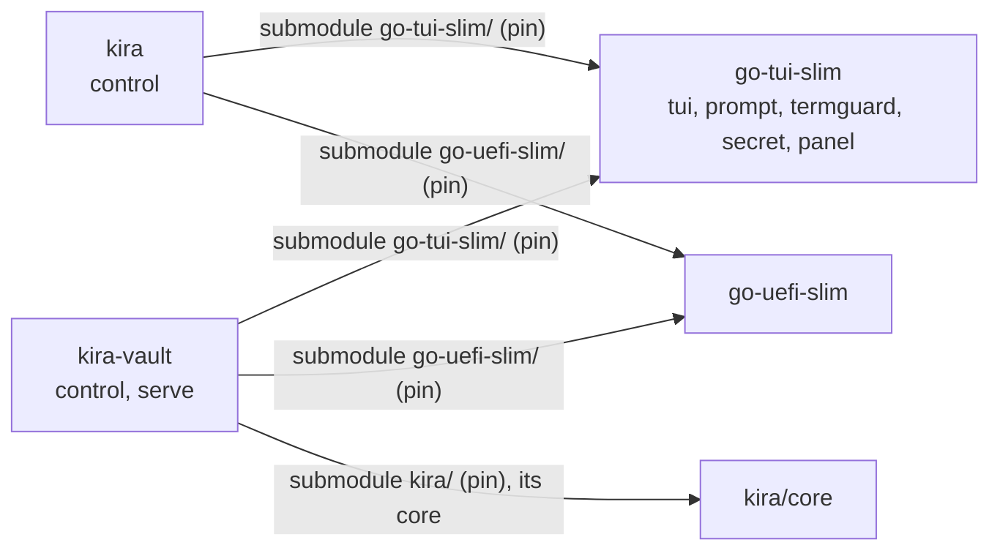

# PLAN: `kira-vault control`

Status: **confirmed by the owner (2026-11-07)**, the vault's keys and their
approval included; A done (go-tui-slim's `panel` in kira's control); B and C
started on the owner's word (2026-11-07), branch `feat/vault-keys`.

## Goal

A guided control panel for the vault server, in the spirit of `kira control`:
one full screen (sections, steps marked done/open/blocked/dirty, the detail, the
command each step equals, search), line menus with `--lines`, a plain printout
without a terminal. It takes a person from an empty host to a serving vault with
machines enrolled - under the systemd unit or in a container - and then runs the
day-to-day work: the queue, devices, operators, approvals of a new boot state. Everything it does stays
doable by hand.

## What setting up a vault takes today (and where it goes wrong)

| # | Step | Command | Checks now | Where people go wrong |
|---|---|---|---|---|
| 1 | install | `make build && make install` | - | the unit's `ConditionPathExists=config.json`: enabled before `init`, it is silently skipped |
| 2 | create | `init --url --listen --pcrs --tpm --admin-socket --operator-listen` | TPM seals and unseals; URL is https with a host; operator-listen not the listen address | the leaf is made for the URL's host alone (DNS name or IP SAN): machines that reach the vault by another name fail TLS, and URL/listen cannot be changed after init (only a new vault); `--pcrs ""` (warned); `--tpm` a swtpm socket = keys bound to nothing (not said); `--tpm` other than `/dev/tpmrm0` or `--admin-socket` outside `/run/kira-vault` break under the unit (`DeviceAllow`, `ProtectSystem=strict`) |
| 3 | recovery key | printed once by init | - | not written down; never verified until a reseal needs it |
| 4 | run | `systemctl enable --now kira-vault` | - | TCP 8443 not opened; 8444 opened to the world instead of operators only |
| 5 | root to machines | `tls root > vault-ca.pem` | - | copied without the pin; the pin comes with the token |
| 6 | per machine | `token create --name [--mode] [--ttl 1h] [--replace]` | name; mode | token expires in 1 h, works once; expired tokens stay in `tokens/` and are not listable; `--replace` forgotten for a re-enrolment |
| 7 | the machine's side | `kira control` → Disk unlock → vault, or `luks enrol … --url --pin --token --ca` | kira's | the boot image without network; Secure Boot not on (the vault releases nothing) |
| 8 | operators | `config set operator-listen` (serve stopped), `operator add NAME` | lock held → refused | done while serve runs (ErrLocked); the bearer token shown once |
| 9 | daily | `requests answer`, `request approve|deny`, `device revoke|unrevoke|unlock|mode`, `audit` | pepper required for pepper devices | a request expires after 15 min (`PendingTTL`); a device locks after 5 failures (`MaxFailures`) |
| 10 | vault firmware/SB change | `systemctl stop; reseal [--pcrs]; systemctl start` | recovery key's public half | nothing tells the person that a reseal is due: releases just fail |

Pending requests and keyboard layouts live only in serve's memory; config,
devices, tokens and operators are files under `/var/lib/kira-vault`
(`init`, `config`, `reseal` need the directory lock that serve holds).

## Decided: the shared UI is a workspace module, `go-tui-slim`

`internal/tui`, `internal/prompt` and the screen of `internal/admin/control_screen.go`
are generic but internal to kira, which the vault cannot import (Go forbids
it; the vault depends on kira's core alone). They move into
`github.com/tpm2-trust/go-tui-slim` (stdlib and x/sys alone), which both
kira and the vault use:

- `tui` (text, terminal, keys, frames, Hush), `prompt` (menus, lines, yes/no,
  secret lines), `termguard`, `panel` (the screen model, extracted from
  `control_screen.go`), `secret`: `Wipe`, `LockedBuffer(n)`, `LockProcess()`
  (mlockall current+future, `PR_SET_DUMPABLE` 0; used by the vault's CLI and
  serve).
- **prompt off diskkey:** `Prompter.SecretBuffer func() []byte` (default
  `secret.LockedBuffer(MaxSecret)`, `MaxSecret = 512`). kira sets it to
  `diskkey.PassphraseBuffer`, so its buffer and its journal line stay as now.
- kira: `internal/tui`, `internal/prompt`, `internal/termguard` and
  `internal/wipe` go; every user switches (`signing/pin.go` to termguard, all
  `wipe.Bytes` to `secret.Wipe`).
- Rejected: into the core (a UI change becomes a protocol change of phone and
  vault), a copy (forbidden), aSSH (not its domain).

**Pins:**

- go-tui-slim: a submodule in each consumer, `kira/go-tui-slim` and
  `kira-vault/go-tui-slim`, `replace ./go-tui-slim` in each go.mod (not
  nested through the vault's `kira/`: the vault's UI does not move with the
  core pin).
- go-uefi-slim (for the vault host's Secure Boot state, below): a submodule
  `kira-vault/go-uefi-slim`, `replace ./go-uefi-slim`, like kira's.
- `pin`: `SUBMODULES` gets `"kira go-tui-slim go-tui-slim"`,
  `"kira-vault go-tui-slim go-tui-slim"`, `"kira-vault go-uefi-slim
  go-uefi-slim"`; a `go-tui-slim)` case and its usage line; `go-tui-slim` in the
  dirty-checkout loop of `status`; `AUR_PINS` gets `"_tuislim go-tui-slim"`.
  `nested()` already covers the vault's `kira/go-tui-slim`.
- go.work: `use ./go-tui-slim`, `replace github.com/tpm2-trust/go-tui-slim
  v0.0.0 => ./go-tui-slim` (go-uefi-slim's replace is there already).
- Workspace AGENTS.md: rows in "The projects" and the consumer table (go-tui-slim
  for both; go-uefi-slim for the vault), the diagram, "What to test" (`go-tui-slim/`:
  its tests; kira's `make test-all` and the vault's tests after
  `./pin go-tui-slim`); `tools/test-affected.py` learns it.

## Decided: deployments - the unit, a container, or neither

`init` refuses a `--tpm` or `--admin-socket` the shipped deployments cannot reach:
the TPM must be `/dev/tpmrm0` (or `/dev/tpm0` where there is no resource manager),
the socket under `/run/kira-vault/`. Both are the same paths inside the
container. Tests still need temporary sockets and swtpm:

- in-process tests (package main, `-tags integration`) replace the check
  (`var reachable = checkReachable`, like `newSealer`), which nothing at run
  time can reach;
- a binary for kira's vmtest (swtpm in its container) is built with the tag
  `vault_test_swtpm`, which alone allows a socket TPM; `make build` and the
  Containerfile never name it, and a release check refuses a binary built with it
  (as kira's `release-binary-check.sh` does for `kira_test_fast_kdf`).

**The container** (`packaging/Containerfile`, the vault's own; kira's
`tools/vmtest-vault` stays the test's):

- `FROM scratch`, the static binary (`CGO_ENABLED=0`, pinned core), `ENTRYPOINT
  ["/kira-vault"]`, `CMD ["serve"]`.
- Run (podman, docker alike; also as a Quadlet `packaging/kira-vault.container`
  so that systemd starts it):
  `--name kira-vault --device /dev/tpmrm0 --group-add <tss gid> --read-only
  --cap-drop ALL --security-opt no-new-privileges --userns auto (docker:
  userns-remap) --ulimit memlock=-1:-1 --ulimit core=0 -v
  /var/lib/kira-vault:/var/lib/kira-vault:Z -v
  /run/kira-vault:/run/kira-vault:Z -p 8443:8443 [-p
  MGMT-ADDR:8444:8444]`, and read-only for the approval's checks: `-v
  /sys/kernel/security:/sys/kernel/security:ro` (the firmware's event log) and
  `-v /run/log/systemd/tpm2-measure.log:/run/log/systemd/tpm2-measure.log:ro`.
  Only the TPM device, no other device; no capability (ports above 1024).
- `init` and `config` run in the container too (`podman run --rm -it` with the
  same device and volumes, serve's container stopped), so the files belong to
  the container's mapped uid; `approve` runs in serve's container (`podman exec
  -it kira-vault kira-vault approve`) while serve runs. The panel runs
  and shows exactly those commands.
- control runs on the host: the admin socket is on the volume; the host's root
  reaches it. Its owner check accepts the container's mapped uid.

**How the panel tells them apart:** `SO_PEERCRED` on the admin socket gives
serve's pid in the host's namespace. Its `/proc/PID/cgroup` names
`kira-vault.service` → under the unit; a `libpod-`/`docker-` scope, or
a user namespace other than the panel's (`/proc/PID/ns/user`) → in a container
(engine and name then from `podman|docker inspect kira-vault`); anything
else → "serve runs, neither under the unit nor in a container": said, nothing
offered to stop or start it. serve not running: the unit or the Quadlet is
looked for; if neither is installed, the Setup section offers both ways.

## Decided: the vault's keys - one master, imported; approvals signed in its TPM

Replaces today's per-device `K_dev` sealed to the vault's PCRs, its copy to the
recovery key, and `reseal`.

**The master key.**

- `init` draws one 32-byte master in locked memory and shows it once as **the
  backup**, the vault's only recovery secret. It imports the master into the
  vault's TPM and wipes it.
- The import: TPM2_Import under the storage primary, as a keyedHash HMAC-SHA256
  object, with `sign` set and `userWithAuth` clear. The duplicate has an outer
  wrapper for the primary's public key (go-tpm's `CreateDuplicate`: its seed
  encapsulated to that key, the sensitive area encrypted and integrity-protected
  for it), so it is not on the bus in the clear - parameter encryption alone would
  not do: it covers a command's first parameter, and Import's is the inner
  wrapper's key, not the duplicate. The imported object is not fixedTPM: the master
  existed once, at init, and after that only in the backup. Its obfuscation value
  is derived from the master (HKDF), so the public area follows from the backup
  alone. Its public and private blobs go into `master.json`.
- Each machine's key is derived in the TPM: `K_dev = TPM2_HMAC(master, device ID
  ‖ r_dev)`, with `r_dev` 32 random bytes per device, kept in its record.
  K_dev only ever lives in locked memory, and it is wiped after each release or
  enrolment. The machine's wrapped R stays encrypted under K_dev (AES-256-GCM,
  the device ID as AAD), as now.
- **Revoke** deletes `r_dev`: the device's key cannot be made again, by anyone,
  with or without the backup. `device unrevoke` goes; the way back is a new
  enrolment (`--replace`).
- **Restore:** `init --restore` imports the backup into a new TPM. It needs the
  state directory too (the `r_dev` values and the records), restored from a
  backup of it.
- **Backup check:** `backup check` asks for the backup and rebuilds the public
  area's `unique` (H(seed ‖ key)). It compares that with `master.json`'s public
  area. No check value of the master is stored anywhere.

**The master's policy** (an AND, as in kira's slots):

    authPolicy = PolicyAuthorize(approval key, policyRef) ; PolicyCommandCode(TPM2_HMAC)

- The approved part is `PolicyPCR(selection, values) ; PolicyNV(counter == N)`
  (the counter: open questions, decided 2). The approval key signs its digest
  (`aHash = H(approvedPolicy ‖ policyRef)`), and the session runs PolicyPCR →
  PolicyNV → PolicyAuthorize(ticket) → PolicyCommandCode.
- With a YubiKey as the second approval key, the master's authPolicy is
  `PolicyOR(branch TPM key, branch YubiKey)`. Each branch is that same AND
  with its own key.
- The digests are computed with core's `attest.PolicyDigest`/`PolicyStep`.
  Core keeps its `policyAuthorize` step unexported, so the vault uses go-tpm's
  `tpm2.PolicyAuthorize{…}.Update` directly until core exports it (a core
  change, with `./pin kira`). Sessions are explicit and flushed on every
  way out, as in kira.

**The approval key.**

- It lives in the vault's own TPM, under the storage primary, as an unrestricted
  signing key. Its authValue is a PIN, asked twice at init, and it is
  dictionary-attack protected (noDA clear).
- Its algorithm is RSA at the greatest length the TPM accepts (`TPM2_TestParms`;
  swtpm 3072, many TPMs 2048), by the workspace's key rule.
- The optional YubiKey key is PIV RSA 2048, or longer where the token takes it.
- **An approval** (`approve`, and the first one at init): the operator enters the
  PIN, the TPM signs the policy over the live values of the selection, and the
  signature, the values, the time and who signed (TPM key or YubiKey) go into
  `approvals/<time>.json`. The panel lists them.
- serve takes the approval whose values match the live PCRs.
- **The approval refuses:**
  - **PCR 7** whose event log says Secure Boot is off or in Setup Mode (core's
    `attest.EstablishSecureBoot`, over `/sys/kernel/security/tpm0/binary_bios_measurements`).
  - **PCR 15** that does not hold the measurement of the encrypted volume the
    state directory is on. The check:
    1. Replay systemd's measurement log (`/run/log/systemd/tpm2-measure.log`).
    2. Compare the replay with the live PCR 15.
    3. Find the state directory's volume: `stat` → `/sys/dev/block/M:m` →
       its dm-crypt holder, whose `dm/uuid` and `dm/name` give the LUKS UUID.
    4. Require the `cryptsetup:<name>:<uuid>` event in the log. It is written
       by systemd-cryptsetup with `tpm2-measure-pcr=yes` (crypttab), and the
       panel advises that line, never edits it.
- **Default selection `7,15`.** Approvals are then due only on a db/dbx update or
  a re-encryption, not on kernel updates. 11 and 4 are optional.

**With kira installed on the vault host:**

- kira's close extends PCR 15 with a fixed event before any volume opens,
  and logs it into the same log. PCR 15 is then deterministic for the host.
- kira's slots need PCR 15 zero before the close, and the vault reads it
  after: no conflict.

**Limits, written down in the docs and said by the panel:**

- **Debian's initramfs-tools `cryptroot` measures nothing.** The vault says so,
  and falls back to a start check: serve refuses unless the state directory is
  on dm-crypt. The PCR 15 refusal then only replays what is there.
- **kira's close falling back to killing the hierarchies** leaves the vault
  without a TPM in that boot. serve refuses to serve, and says why.

**"Approval due"** needs no unseal and no canary. The panel compares the live
PCRs with the approved values, and a trial policy session's digest after
PolicyPCR with the approved policies.

**What goes:** `reseal`, the recovery key, `recovery check`, `device unrevoke`,
`keys.RecoveryKey` and its per-device copies, `Device.Sealed` and
`Device.Recovery`.

## The panel

`kira-vault control [--dir DIR] [--socket PATH] [--lines] [--debug]`, root
only. Facts in two passes, as in kira: fast (files, config, the unit's or
container's state, the host's Secure Boot from its EFI variables through
go-uefi-slim's `efivar`), then slow in the background ("checking"): serve's
`/v1/status`, a TLS handshake to each listen address verified against the root
and the pin (`tlsutil.ClientConfig`, SNI = the URL's host), the URL host's DNS.
The panel never opens the TPM itself (serve has it) and never calls
`tlsutil.Load` (it renews and writes); it reads `cert.pem` and `ca.pem`.

| Section | Lines (judged: green / orange / red with the risk) and steps | Equals |
|---|---|---|
| Overview | root; deployment (unit / container / neither); state dir 0700, on an encrypted volume, measured into PCR 15 (red when not: the crypttab line advised); TPM reachable, manufacturer (from serve); the vault host's Secure Boot (off or Setup Mode red); the selection (without 7 or 15 orange, with the reason); **approval due** (red: "the boot state changed: approve it"; from the live PCRs against the approvals, no unseal); the approval keys (TPM, YubiKey) and the TPM's dictionary-attack state (in lockout red); URL host = leaf's name, resolves, a local address (orange when not: NAT); leaf and root validity; machines' port answers, verified; operator port on/off, on all addresses (orange); admin socket 0600, its owner, answers; devices: count, any locked/revoked/Secure Boot not on; unused and expired tokens; pending requests (the recommended step) | `systemctl status` / `podman ps`, `status`, `devices`, `requests` |
| Setup | **Create the vault** (guided init: URL proposed from hostname and addresses, its cert-name consequence said; listen; selection `7,15` with what each costs; the approval PIN twice; operator interface yes/no; in a container: the `podman run --rm` form; the backup shown once); **restore** from a backup into this TPM; **check the backup**; **a YubiKey as second approval key**; **run it**: the unit (`enable --now`) or the container (the Quadlet, or the run line); firewall advice for 8443/8444, never edited | `init …`; `init --restore`; `backup check`; `approval-key add --yubikey`; `systemctl enable --now kira-vault[-container]` |
| Machines | **Enrol a machine** (name, mode, ttl, replace: token create; the token once, URL, pin, the line for `kira control`'s vault step and `luks enrol`; offers to write the root to a file); **unused tokens** (each a line: withdraw ⚠); **each device** a line: show, mode, unlock, revoke ⚠ | `token create …`; `token withdraw ID`; `device …` |
| Requests | each pending request a line: approve (pepper asked where needed) / deny; a released keyboard request: **show its layout** (on Enter only, never in the detail pane) | `request approve|deny ID` |
| Operators | interface on/off (stops and starts serve, asked); add (token once); each operator a line: remove ⚠ (typed name) | `config set operator-listen`; `operator add|remove` |
| Approvals | **Approve this boot state** (shows old and new values and what moved them - PCR 7's events, PCR 15's - the refusals' verdicts, then the PIN or the YubiKey); **every approval** a line: values, when, by which key; show root and pin | `approve [--yubikey]`; `approvals`; `tls root` |
| Tools | `status`, `devices`, `requests`, `operators`, `approvals`, `audit`, `audit --follow`, `tls root`, `token list` run as they are | the same |
| Reference | `help` | `help` |

Danger: view / change / destroy as in kira. Destroying (typed word):
device revoke (the device's name: its key is gone for good), operator remove
(its name), token withdraw (`withdraw`). A new vault over an existing one is not
offered (`rm -r` of the state directory by hand, with what it costs said in
Reference).

**Secrets: what the panel never shows or logs.** The backup, enrolment tokens
and operator tokens are printed once, in the step's run below the screen, never
in a frame, the detail pane or `--debug`; after the step the screen and
scrollback are cleared (`\033[3J`). After init the panel asks for the backup's
last group back before going on. The backup, the approval PIN, the YubiKey's
PIN and peppers are read with `prompt.Password` into locked buffers, used and
wiped; never echoed, logged or kept. The pepper's approve body is built into a
locked buffer by hand (no `encoding/json` string copy) and sent over the admin
socket. A keyboard layout is shown only on request. `--debug` logs method and
path of admin calls, never bodies or answers. The panel talks to serve only
through the admin socket, as the CLI. Every command that holds a secret, the
panel and serve call `secret.LockProcess()` first.

## Steps

Each committable and testable alone. **A3 and A4 touch kira and wait until
the other session's change there (the sweep in `internal/admin/slot_admin.go`
and control) is merged**; A1, A2 and the B steps do not wait.

- [x] **A1** (go-tui-slim 134f1f1) New repository `go-tui-slim` (workspace checkout `go-tui-slim/`):
  `tui`, `prompt`, `termguard` taken over from kira with their tests (they
  leave kira in A3); `secret` (Wipe, LockedBuffer, LockProcess, with tests);
  prompt's `SecretBuffer`/`MaxSecret` instead of diskkey. `go test ./...`.
- [x] **A2** (the workspace `fa90cb7`) **The owner first creates github.com/tpm2-trust/go-tui-slim** (done,
  2026-11-07). Then the workspace: go.work, `pin` (SUBMODULES for go-tui-slim and
  the vault's go-uefi-slim, the case, usage, status loop, AUR_PINS), AGENTS.md
  rows, `test-affected.py`.
- [x] **A3** (kira `b815067`, aSSH `b7587d5`) kira: submodule `go-tui-slim/`, `replace`,
  imports switched; `internal/tui`, `internal/prompt`, `internal/termguard`,
  `internal/wipe` removed, every `wipe.Bytes` → `secret.Wipe`;
  `SecretBuffer = diskkey.PassphraseBuffer`; `boot_binary_test.go` still keeps
  prompt out of the boot binary; AUR `_tuislim`. `make test-all`, control's pty
  tests.
- [x] **A4** (go-tui-slim `61367e7`, kira `41c46a7`) `panel` in go-tui-slim: `Section`, `Step` (Key,
  Title, Explain, Done, Blocked, Dirty, Optional, Danger, Destroys, Command, Run
  func() error), `Model`, `State` (keys, search, frame, sidebar, detail, status
  row), `Loop`, the run below the screen, the typed confirmation; extracted from
  `control_screen.go` with its frame/keys/pty tests. kira's control adapts;
  `make test-all`; nothing it shows changes.
- [x] **B1** (`cdcaa04`) Vault refactor: `adminClient` → `internal/adminclient`; renderers
  (`printDevice`, `printLayout`, `secureBootLine`, `formatEntry`) →
  `internal/view`. No behaviour change; `make test`.
- [x] **B2** Memory and reach (peppers as bytes through `internal/secretjson`, both ways): the vault requires go-tui-slim and go-uefi-slim
  (submodules, `replace`); `secret.LockProcess()` in serve and in every command
  holding a secret; secrets read into locked byte buffers, not strings;
  `LimitMEMLOCK=infinity` in the unit (`LockProcess` refuses a finite limit without `CAP_IPC_LOCK`, which the unit does not give). `init` refuses an unreachable
  `--tpm`/`--admin-socket` (the test hook, the `vault_test_swtpm` tag, the
  release check in `make build`); kira's `tools/vmtestlib.py` builds the
  vault with the tag. Tests.
- [x] **B3** (`keys/master.go`, `backup.go`, `vaulttpm.go`; swtpm: the TPM's HMAC is
  the master's, a wrong PIN, a moved PCR, an older and a forged approval refused,
  two keys under PolicyOR; the digests pinned) The counter's policy, like the master's,
  is the PolicyOR of every approval key's branch (PolicySigned ; PolicyCommandCode
  (NV_Increment)), so that a second key raises it too; adding a key makes the master
  (from the backup) and the counter again. The backup is base32 of the master and two
  check bytes (a typo is caught where it is typed), 11 groups of five. `keys.RecoveryKey`
  and the sealer go in B5, with their last user. `internal/keys`: the master (`Import`: keyedHash HMAC, no outer
  wrapper, parameter-encrypted salted session; `Derive(id, r)`: TPM2_HMAC in a
  policy session flushed on every way out), the approval key (`CreateApprovalKey`
  with a PIN, DA-protected, RSA by `TPM2_TestParms`), the policy digests (core's
  `PolicyDigest`; PolicyOR for a second key), `ApprovalSign`/`approvals/` files,
  `backup check`'s public-area rebuild. `keys.RecoveryKey` and the sealer go.
  Tests against swtpm (`-tags integration`), known answers for the digests.
- [x] **B4** (the firmware's log read with go-attestation v0.6.4, as kira reads it - one
  parser for both, fuzzed, with its firmware workarounds; the owner, 2026-11-07. The rules:
  PCR 7 refuses unless on; PCR 15 refuses without a dm-crypt volume under the state
  directory, a log that does not replay, or - where systemd-cryptsetup measures volumes -
  the volume's event missing; where nothing measures volumes it is a note, and serve's
  start check stands. The volume through `/sys` and, where a file's device is none (btrfs),
  the mount's source) The approval's evidence (`internal/bootstate`): PCR 7 through
  `attest.EstablishSecureBoot` over the firmware's event log; PCR 15 by replaying
  systemd's measurement log, the state directory's volume found through `/sys`
  and its `cryptsetup:` event; the dm-crypt start check where nothing is
  measured. Unit tests on fixture logs and a fixture `/sys` tree.
- [x] **B5** (decided while doing it: serve starts without an approval of the live state,
  says so in its log and denies every release and enrolment with the advice to approve;
  with PCR 15 in the selection it refuses to start unless the state directory is on
  dm-crypt; approve and approvals run beside serve, which reads the approvals at each
  release; the selection is at least one PCR, 7 and 15 by default; kira's vmtest approves
  PCR 23, a software TPM having no firmware log for PCR 7. The YubiKey as a second
  approval key is its own step after C: the master's and the counter's policies take
  several keys already, a key added makes both again from the backup) The vault on the master: `init` (draws, shows the backup, the PIN,
  imports, the approval key, the first approval), `init --restore`, `approve
  [--yubikey]`, `approvals`, `backup check`, `approval-key add --yubikey`;
  enrolment stores `r_dev`, a release derives `K_dev`; `device revoke` deletes
  `r_dev`, `device unrevoke` and `reseal` go; serve refuses without an approval of
  the live state (says so) and without a TPM. State files: `master.json`,
  `approvals/`, the device record without `Sealed`/`Recovery`. Server tests;
  `TestVaultOnSWTPM` across an approval (PCR extended in swtpm, release refused,
  approved, released).
- [x] **B6** (the TPM's maker and dictionary-attack state through GetCapability; the certificates read at each request, the leaf being renewed while serve runs) Admin endpoints (admin socket only): `GET /v1/status` (version,
  URL, listen, operator listen, pin, selection, approval due and the values that
  differ, the approval keys, TPM path, manufacturer, DA state, leaf/root NotAfter,
  counts, started at); `GET /v1/tokens` (name, mode, expires, replace, ID = first
  16 hex of the hash); `DELETE /v1/tokens/{id}`, audited. CLI: `status`, `token
  list`, `token withdraw ID`. Server tests.
- [ ] **B7** The container: `packaging/Containerfile`, the Quadlet
  `packaging/kira-vault.container`, `make container`. Test: build it, run it
  against a TPM device where one is available (swtpm `cuse` or the vTPM proxy),
  else skipped with the reason; vmtest's vault container may move onto it later.
- [ ] **C1** `internal/control`: facts (`facts.go`: fast/slow, deployment
  detection, the host's Secure Boot via go-uefi-slim, approval due, the judged
  lines), model (`model.go`: sections, steps, states, commands, danger), line
  mode and the printout without a terminal. Unit tests on fixture facts: every
  step's state and command, every red line's condition, each deployment.
- [ ] **C2** Full screen on `panel`; `control` in main.go and the usage; the pty
  test (kira's `control_screen_test.go` pattern: `unix.Openpt`, keys in,
  frame out, terminal restored on q/Ctrl-C).
- [ ] **C3** Guided actions: init and restore, run it (unit/container), enrol a
  machine, tokens, devices, requests with pepper, operators with serve stopped
  and started, approve, backup check. Tests against a fake admin socket
  (`httptest` on a Unix socket) and the line mode fed through a pipe.
- [ ] **C4** Integration (`-tags integration`, swtpm): `TestControlOnSWTPM`:
  `control --lines` creates the vault, serve in-process (`serve(ctx, d, …,
  ready)`), enrol token, operator add, a PCR extended → "approval due" → approve
  → green; the overview green except the TPM line where it must be.
- [ ] **C5** kira `tools/vmtest.py`: one check in the vault scenarios -
  `kira-vault control` without a terminal after the enrolment: the device
  listed, Secure Boot on, the deployment "in a container". Docs: kira
  `docs/VAULT.md` (§2 keys, §3 setup with control and the container, §6.2 keys
  at rest, §6.5 recovery: backup and restore, approvals; §6.6 commands); this
  README's "In short".

Testing per the workspace table: A the module's tests, kira's
`make test-all` and the vault's tests after `./pin go-tui-slim`; B/C the
vault's `make test` and `make test-integration`, the vmtest vault scenarios at
the end of the batch.

## What breaks

- **Every vault is set up again (`init`) and every machine enrolled with it
  again** (B5): the device records, `reseal` and the recovery key go; a state
  directory of today is refused with "make the vault again with init". The
  owner: a new `init` on each vault host (write down the backup, choose the
  approval PIN), then on each machine a new token and `kira luks enrol …
  --salt vault` (or control's vault step), the old vault keyslot removed.
- **Revoke is final:** `device unrevoke` is gone; a revoked machine comes back
  only by a new enrolment.
- **The vault host:** the state directory belongs on an encrypted volume
  measured into PCR 15 (`tpm2-measure-pcr=yes` in crypttab); otherwise the
  approval refuses PCR 15 (or, on Debian's initramfs-tools, serve checks only
  for dm-crypt).
- **`init` refuses** a `--tpm` other than the hardware device and an
  `--admin-socket` outside `/run/kira-vault/`; only a `vault_test_swtpm`
  test build takes a socket TPM. kira's vmtest builds the vault with that
  tag (B2, in the same batch).
- **Memory locking:** serve and the secret-holding commands stop if they cannot
  lock: the unit gets `LimitMEMLOCK=infinity`, the container line `--ulimit memlock=-1:-1`.
- kira and the vault need the new submodules to build
  (`--recurse-submodules`; AUR `_tuislim`). kira's control looks and
  behaves the same.

## WARNING (existing code, fixed by B2 and B5)

- The vault's CLI holds the **recovery key** (`readSecret`) and **peppers**
  (`asker`, `ApproveRequest.Pepper *string`) as Go strings: unlocked, not
  wipeable; the CLI runs outside the unit, so `LimitCORE=0` does not cover it
  and the process is dumpable. serve neither locks memory nor sets not-dumpable.
- The unit's `DeviceAllow=/dev/tpmrm0` and `ProtectSystem=strict` silently
  contradict `init --tpm`/`--admin-socket` other than the defaults, and
  `ConditionPathExists` hides a start before init.

## Open questions

None open on the keys. Decided by the owner (2026-11-07):

1. **The fixed part is `PolicyCommandCode(TPM2_HMAC)` alone.** The PCR values come only
   through approvals (signed per approval); no PCR value is fixed at import - that would
   make every change of it a new import from the backup.
2. **Rollback is closed by a counter.** Every approval names the value of an NV counter
   of the vault's (`PolicyNV(counter == N)` in the approved part); a new approval first
   raises the counter, so every older approval fails in the TPM, whatever the PCRs. Going
   back to an older state on purpose is a new approval. The counter: an NV index of type
   counter at the vault's own handle 0x01804000 - outside kira's range
   (0x01803000-0x01803FFF, which its sweep takes) and aSSH's (0x018029xx) - defined by
   the vault's own code, noDA, incremented only with the approval key (its write policy),
   so nobody else can lock the vault out by raising it. The panel shows its value with
   each approval.
