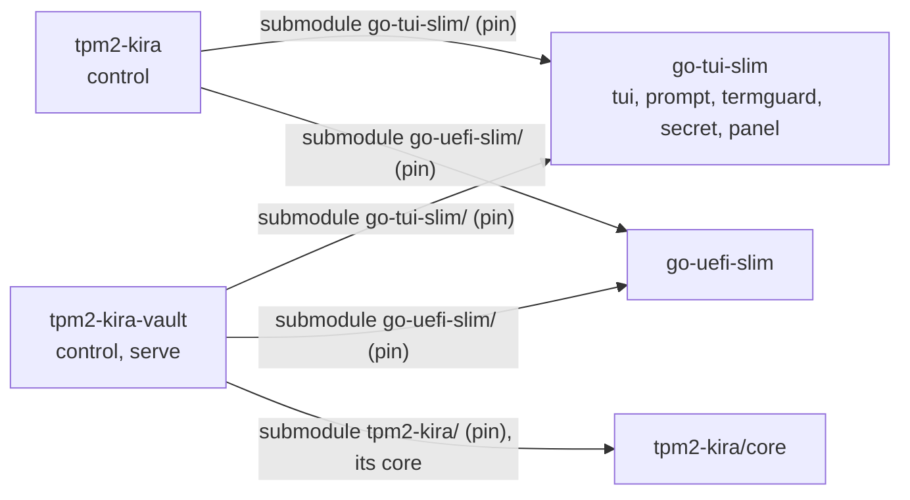

# PLAN: `tpm2-kira-vault control`

Status: **confirmed by the owner (2026-11-07)**, except open question 1 (the seal
check). No code before the word to start.

## Goal

A guided control panel for the vault server, in the spirit of `tpm2-kira control`:
one full screen (sections, steps marked done/open/blocked/dirty, the detail, the
command each step equals, search), line menus with `--lines`, a plain printout
without a terminal. It takes a person from an empty host to a serving vault with
machines enrolled - under the systemd unit or in a container - and then runs the
day-to-day work: the queue, devices, operators, reseal. Everything it does stays
doable by hand.

## What setting up a vault takes today (and where it goes wrong)

| # | Step | Command | Checks now | Where people go wrong |
|---|---|---|---|---|
| 1 | install | `make build && make install` | - | the unit's `ConditionPathExists=config.json`: enabled before `init`, it is silently skipped |
| 2 | create | `init --url --listen --pcrs --tpm --admin-socket --operator-listen` | TPM seals and unseals; URL is https with a host; operator-listen not the listen address | the leaf is made for the URL's host alone (DNS name or IP SAN): machines that reach the vault by another name fail TLS, and URL/listen cannot be changed after init (only a new vault); `--pcrs ""` (warned); `--tpm` a swtpm socket = keys bound to nothing (not said); `--tpm` other than `/dev/tpmrm0` or `--admin-socket` outside `/run/tpm2-kira-vault` break under the unit (`DeviceAllow`, `ProtectSystem=strict`) |
| 3 | recovery key | printed once by init | - | not written down; never verified until a reseal needs it |
| 4 | run | `systemctl enable --now tpm2-kira-vault` | - | TCP 8443 not opened; 8444 opened to the world instead of operators only |
| 5 | root to machines | `tls root > vault-ca.pem` | - | copied without the pin; the pin comes with the token |
| 6 | per machine | `token create --name [--mode] [--ttl 1h] [--replace]` | name; mode | token expires in 1 h, works once; expired tokens stay in `tokens/` and are not listable; `--replace` forgotten for a re-enrolment |
| 7 | the machine's side | `tpm2-kira control` → Disk unlock → vault, or `luks enrol … --url --pin --token --ca` | tpm2-kira's | the boot image without network; Secure Boot not on (the vault releases nothing) |
| 8 | operators | `config set operator-listen` (serve stopped), `operator add NAME` | lock held → refused | done while serve runs (ErrLocked); the bearer token shown once |
| 9 | daily | `requests answer`, `request approve|deny`, `device revoke|unrevoke|unlock|mode`, `audit` | pepper required for pepper devices | a request expires after 15 min (`PendingTTL`); a device locks after 5 failures (`MaxFailures`) |
| 10 | vault firmware/SB change | `systemctl stop; reseal [--pcrs]; systemctl start` | recovery key's public half | nothing tells the person that a reseal is due: releases just fail |

Pending requests and keyboard layouts live only in serve's memory; config,
devices, tokens and operators are files under `/var/lib/tpm2-kira-vault`
(`init`, `config`, `reseal` need the directory lock that serve holds).

## Decided: the shared UI is a workspace module, `go-tui-slim`

`internal/tui`, `internal/prompt` and the screen of `internal/admin/control_screen.go`
are generic but internal to tpm2-kira, which the vault cannot import (Go forbids
it; the vault depends on tpm2-kira's core alone). They move into
`github.com/tpm2-trust/go-tui-slim` (stdlib and x/sys alone), which both
tpm2-kira and the vault use:

- `tui` (text, terminal, keys, frames, Hush), `prompt` (menus, lines, yes/no,
  secret lines), `termguard`, `panel` (the screen model, extracted from
  `control_screen.go`), `secret`: `Wipe`, `LockedBuffer(n)`, `LockProcess()`
  (mlockall current+future, `PR_SET_DUMPABLE` 0; used by the vault's CLI and
  serve).
- **prompt off diskkey:** `Prompter.SecretBuffer func() []byte` (default
  `secret.LockedBuffer(MaxSecret)`, `MaxSecret = 512`). tpm2-kira sets it to
  `diskkey.PassphraseBuffer`, so its buffer and its journal line stay as now.
- tpm2-kira: `internal/tui`, `internal/prompt`, `internal/termguard` and
  `internal/wipe` go; every user switches (`signing/pin.go` to termguard, all
  `wipe.Bytes` to `secret.Wipe`).
- Rejected: into the core (a UI change becomes a protocol change of phone and
  vault), a copy (forbidden), aSSH (not its domain).

**Pins:**

- go-tui-slim: a submodule in each consumer, `tpm2-kira/go-tui-slim` and
  `tpm2-kira-vault/go-tui-slim`, `replace ./go-tui-slim` in each go.mod (not
  nested through the vault's `tpm2-kira/`: the vault's UI does not move with the
  core pin).
- go-uefi-slim (for the vault host's Secure Boot state, below): a submodule
  `tpm2-kira-vault/go-uefi-slim`, `replace ./go-uefi-slim`, like tpm2-kira's.
- `pin`: `SUBMODULES` gets `"tpm2-kira go-tui-slim go-tui-slim"`,
  `"tpm2-kira-vault go-tui-slim go-tui-slim"`, `"tpm2-kira-vault go-uefi-slim
  go-uefi-slim"`; a `go-tui-slim)` case and its usage line; `go-tui-slim` in the
  dirty-checkout loop of `status`; `AUR_PINS` gets `"_tuislim go-tui-slim"`.
  `nested()` already covers the vault's `tpm2-kira/go-tui-slim`.
- go.work: `use ./go-tui-slim`, `replace github.com/tpm2-trust/go-tui-slim
  v0.0.0 => ./go-tui-slim` (go-uefi-slim's replace is there already).
- Workspace AGENTS.md: rows in "The projects" and the consumer table (go-tui-slim
  for both; go-uefi-slim for the vault), the diagram, "What to test" (`go-tui-slim/`:
  its tests; tpm2-kira's `make test-all` and the vault's tests after
  `./pin go-tui-slim`); `tools/test-affected.py` learns it.

## Decided: deployments - the unit, a container, or neither

`init` refuses a `--tpm` or `--admin-socket` the shipped deployments cannot reach:
the TPM must be `/dev/tpmrm0` (or `/dev/tpm0` where there is no resource manager),
the socket under `/run/tpm2-kira-vault/`. Both are the same paths inside the
container. Tests still need temporary sockets and swtpm:

- in-process tests (package main, `-tags integration`) replace the check
  (`var reachable = checkReachable`, like `newSealer`), which nothing at run
  time can reach;
- a binary for tpm2-kira's vmtest (swtpm in its container) is built with the tag
  `vault_test_swtpm`, which alone allows a socket TPM; `make build` and the
  Containerfile never name it, and a release check refuses a binary built with it
  (as tpm2-kira's `release-binary-check.sh` does for `kira_test_fast_kdf`).

**The container** (`packaging/Containerfile`, the vault's own; tpm2-kira's
`tools/vmtest-vault` stays the test's):

- `FROM scratch`, the static binary (`CGO_ENABLED=0`, pinned core), `ENTRYPOINT
  ["/tpm2-kira-vault"]`, `CMD ["serve"]`.
- Run (podman, docker alike; also as a Quadlet `packaging/tpm2-kira-vault.container`
  so that systemd starts it):
  `--name tpm2-kira-vault --device /dev/tpmrm0 --group-add <tss gid> --read-only
  --cap-drop ALL --security-opt no-new-privileges --userns auto (docker:
  userns-remap) --ulimit memlock=<n> --ulimit core=0 -v
  /var/lib/tpm2-kira-vault:/var/lib/tpm2-kira-vault:Z -v
  /run/tpm2-kira-vault:/run/tpm2-kira-vault:Z -p 8443:8443 [-p
  MGMT-ADDR:8444:8444]`. Only the TPM device, no other device; no
  capability (ports above 1024).
- `init`, `reseal`, `config` run in the container too (`podman run --rm -it`
  with the same device and volumes, serve's container stopped), so the files
  belong to the container's mapped uid; the panel runs and shows exactly that
  command.
- control runs on the host: the admin socket is on the volume; the host's root
  reaches it. Its owner check accepts the container's mapped uid.

**How the panel tells them apart:** `SO_PEERCRED` on the admin socket gives
serve's pid in the host's namespace. Its `/proc/PID/cgroup` names
`tpm2-kira-vault.service` → under the unit; a `libpod-`/`docker-` scope, or
a user namespace other than the panel's (`/proc/PID/ns/user`) → in a container
(engine and name then from `podman|docker inspect tpm2-kira-vault`); anything
else → "serve runs, neither under the unit nor in a container": said, nothing
offered to stop or start it. serve not running: the unit or the Quadlet is
looked for; if neither is installed, the Setup section offers both ways.

## The panel

`tpm2-kira-vault control [--dir DIR] [--socket PATH] [--lines] [--debug]`, root
only. Facts in two passes, as in tpm2-kira: fast (files, config, the unit's or
container's state, the host's Secure Boot from its EFI variables through
go-uefi-slim's `efivar`), then slow in the background ("checking"): serve's
`/v1/status`, a TLS handshake to each listen address verified against the root
and the pin (`tlsutil.ClientConfig`, SNI = the URL's host), the URL host's DNS.
The panel never opens the TPM itself (serve has it) and never calls
`tlsutil.Load` (it renews and writes); it reads `cert.pem` and `ca.pem`.

| Section | Lines (judged: green / orange / red with the risk) and steps | Equals |
|---|---|---|
| Overview | root; deployment (unit / container / neither); state dir 0700; TPM reachable, manufacturer (from serve); the vault host's Secure Boot (off or Setup Mode red: "PCR 7 says nothing of this host's boot"); PCRs (empty red); seal check (red: "reseal due"; see question 1); URL host = leaf's name, resolves, a local address (orange when not: NAT); leaf and root validity; machines' port answers, verified; operator port on/off, on all addresses (orange); admin socket 0600, its owner, answers; devices: count, any locked/revoked/Secure Boot not on; unused and expired tokens; pending requests (the recommended step) | `systemctl status` / `podman ps`, `status`, `devices`, `requests` |
| Setup | **Create the vault** (guided init: URL proposed from hostname and addresses, its cert-name consequence said; listen; PCRs with the reseal consequence; operator interface yes/no; in a container: the `podman run --rm` form); **check the recovery key**; **run it**: the unit (`enable --now`) or the container (the Quadlet, or the run line); firewall advice for 8443/8444, never edited | `init …`; `recovery check`; `systemctl enable --now tpm2-kira-vault[-container]` |
| Machines | **Enrol a machine** (name, mode, ttl, replace: token create; the token once, URL, pin, the line for `tpm2-kira control`'s vault step and `luks enrol`; offers to write the root to a file); **unused tokens** (each a line: withdraw ⚠); **each device** a line: show, mode, unlock, revoke/unrevoke | `token create …`; `token withdraw ID`; `device …` |
| Requests | each pending request a line: approve (pepper asked where needed) / deny; a released keyboard request: **show its layout** (on Enter only, never in the detail pane) | `request approve|deny ID` |
| Operators | interface on/off (stops and starts serve, asked); add (token once); each operator a line: remove ⚠ (typed name) | `config set operator-listen`; `operator add|remove` |
| Maintenance | **Reseal** (stops serve, asks the recovery key, starts it); show root and pin | `systemctl stop …; reseal; systemctl start …` (or the container's); `tls root` |
| Tools | `status`, `devices`, `requests`, `operators`, `audit`, `audit --follow`, `tls root`, `token list` run as they are | the same |
| Reference | `help` | `help` |

Danger: view / change / destroy as in tpm2-kira. Destroying (typed word):
operator remove (its name), token withdraw (`withdraw`). Revoke is a change
(reversible), asked y/N. A new vault over an existing one is not offered
(`rm -r` of the state directory by hand, with what it costs said in Reference).

**Secrets: what the panel never shows or logs.** The recovery key, enrolment
tokens and operator tokens are printed once, in the step's run below the
screen, never in a frame, the detail pane or `--debug`; after the step the
screen and scrollback are cleared (`\033[3J`). After init the panel asks for
the recovery key's last group back before going on. Peppers are read with
`prompt.Password` into a locked buffer, the approve body is built into a locked
buffer by hand (no `encoding/json` string copy), sent over the admin socket and
wiped; never echoed, logged or kept. A keyboard layout is shown only on request.
`--debug` logs method and path of admin calls, never bodies or answers. The
panel talks to serve only through the admin socket, as the CLI. Every command
that holds a secret, the panel and serve call `secret.LockProcess()` first.

## Steps

Each committable and testable alone. **A3 and A4 touch tpm2-kira and wait until
the other session's change there (the sweep in `internal/admin/slot_admin.go`
and control) is merged**; A1, A2 and B1-B5 do not wait.

- [ ] **A1** New repository `go-tui-slim` (workspace checkout `go-tui-slim/`):
  `tui`, `prompt`, `termguard` taken over from tpm2-kira with their tests (they
  leave tpm2-kira in A3); `secret` (Wipe, LockedBuffer, LockProcess, with tests);
  prompt's `SecretBuffer`/`MaxSecret` instead of diskkey. `go test ./...`.
- [ ] **A2** **The owner first creates github.com/tpm2-trust/go-tui-slim** (the
  submodules' URL; a pin resolves for others only once its commit is pushed).
  Then the workspace: go.work, `pin` (SUBMODULES for go-tui-slim and the vault's
  go-uefi-slim, the case, usage, status loop, AUR_PINS), AGENTS.md rows,
  `test-affected.py`.
- [ ] **A3** (after the merge) tpm2-kira: submodule `go-tui-slim/`, `replace`,
  imports switched; `internal/tui`, `internal/prompt`, `internal/termguard`,
  `internal/wipe` removed, every `wipe.Bytes` → `secret.Wipe`;
  `SecretBuffer = diskkey.PassphraseBuffer`; `boot_binary_test.go` still keeps
  prompt out of the boot binary; AUR `_tuislim`. `make test-all`, control's pty
  tests.
- [ ] **A4** (after the merge) `panel` in go-tui-slim: `Section`, `Step` (Key,
  Title, Explain, Done, Blocked, Dirty, Optional, Danger, Destroys, Command, Run
  func() error), `Model`, `State` (keys, search, frame, sidebar, detail, status
  row), `Loop`, the run below the screen, the typed confirmation; extracted from
  `control_screen.go` with its frame/keys/pty tests. tpm2-kira's control adapts;
  `make test-all`; nothing it shows changes.
- [ ] **B1** Vault refactor: `adminClient` → `internal/adminclient`; renderers
  (`printDevice`, `printLayout`, `secureBootLine`, `formatEntry`) →
  `internal/view`. No behaviour change; `make test`.
- [ ] **B2** Admin endpoints (admin socket only): `GET /v1/status` (version,
  URL, listen, operator listen, pin, PCRs, TPM path, manufacturer read at start,
  leaf/root NotAfter, counts, started at, the seal check of question 1);
  `GET /v1/tokens` (name, mode, expires, replace, ID = first 16 hex of the hash;
  no value exists to show); `DELETE /v1/tokens/{id}`, audited. CLI: `status`,
  `token list`, `token withdraw ID`. Server tests.
- [ ] **B3** `recovery check [--dir]`: asks the key, compares its public half
  with config's (constant time), touches nothing; works while serve runs. Test.
- [ ] **B4** Memory and reach: the vault requires go-tui-slim (submodule) and
  calls `secret.LockProcess()` in serve and in every command holding a secret
  (`init`, `reseal`, `recovery check`, `request approve`, `requests answer`,
  `control`); the CLI reads the recovery key and peppers into locked byte
  buffers, not strings; `LimitMEMLOCK=` in the unit. `init` refuses an
  unreachable `--tpm`/`--admin-socket` (the test hook and the
  `vault_test_swtpm` tag above, the release check in `make build`); tpm2-kira's
  `tools/vmtestlib.py` builds the vault with the tag. Tests.
- [ ] **B5** The container: `packaging/Containerfile`, the Quadlet
  `packaging/tpm2-kira-vault.container`, `make container`. Test: build it, run it
  against a TPM device where one is available (swtpm `cuse` or the vTPM proxy),
  else skipped with the reason; vmtest's vault container may move onto it later.
- [ ] **C1** `internal/control`: facts (`facts.go`: fast/slow, deployment
  detection, the host's Secure Boot via go-uefi-slim, the judged lines), model
  (`model.go`: sections, steps, states, commands, danger), line mode and the
  printout without a terminal. Unit tests on fixture facts: every step's state
  and command, every red line's condition, each deployment.
- [ ] **C2** Full screen on `panel`; `control` in main.go and the usage; the pty
  test (tpm2-kira's `control_screen_test.go` pattern: `unix.Openpt`, keys in,
  frame out, terminal restored on q/Ctrl-C).
- [ ] **C3** Guided actions: init, run it (unit/container), enrol a machine,
  tokens, devices, requests with pepper, operators with serve stopped and
  started, reseal, recovery check. Tests against a fake admin socket
  (`httptest` on a Unix socket) and the line mode fed through a pipe.
- [ ] **C4** Integration (`-tags integration`, swtpm): `TestControlOnSWTPM`:
  `control --lines` creates the vault, serve in-process (`serve(ctx, d, …,
  ready)`), enrol token, operator add, the overview green except the TPM line
  where it must be, recovery check.
- [ ] **C5** tpm2-kira `tools/vmtest.py`: one check in the vault scenarios -
  `tpm2-kira-vault control` without a terminal after the enrolment: the device
  listed, Secure Boot on, the deployment "in a container". Docs: tpm2-kira
  `docs/VAULT.md` §3 leads with control and the container, §6.6 the new
  commands; this README's "In short".

Testing per the workspace table: A the module's tests, tpm2-kira's
`make test-all` and the vault's tests after `./pin go-tui-slim`; B/C the
vault's `make test` and `make test-integration`, the vmtest vault scenarios at
the end of the batch.

## What breaks

- **`init` refuses** a `--tpm` other than the hardware device and an
  `--admin-socket` outside `/run/tpm2-kira-vault/`: a vault set up with a swtpm
  socket or another socket path keeps serving but cannot be made again that
  way; only a `vault_test_swtpm` test build takes a socket TPM. tpm2-kira's
  vmtest builds the vault with that tag (B4, in the same batch).
- **Memory locking:** serve and the secret-holding commands stop if they cannot
  lock (no `LimitMEMLOCK`, a container without `--ulimit memlock`): the unit
  gets `LimitMEMLOCK=`, the container line `--ulimit`.
- Otherwise nothing for a running vault: no `init` again, the admin API only
  grows, the operator interface is unchanged. With the canary (question 1, b) an
  existing vault shows "seal check unknown - reseal to know" until its next
  reseal.
- tpm2-kira and the vault need the new submodules to build
  (`--recurse-submodules`; AUR `_tuislim`). tpm2-kira's control looks and
  behaves the same.

## WARNING (existing code, fixed by B4)

- The vault's CLI holds the **recovery key** (`readSecret`) and **peppers**
  (`asker`, `ApproveRequest.Pepper *string`) as Go strings: unlocked, not
  wipeable; the CLI runs outside the unit, so `LimitCORE=0` does not cover it
  and the process is dumpable. serve neither locks memory nor sets not-dumpable.
- The unit's `DeviceAllow=/dev/tpmrm0` and `ProtectSystem=strict` silently
  contradict `init --tpm`/`--admin-socket` other than the defaults, and
  `ConditionPathExists` hides a start before init.

## Open question (with the owner)

1. **The seal check** - does the vault's TPM still unseal under its PCRs, i.e.
   is a reseal due?
   - (a) serve unseals one real device key under its mutex and wipes it. No new
     state; but a real key is in memory for a check, and with no device
     enrolled there is nothing to check.
   - (b) **a canary**: a worthless random secret sealed with the same PCR policy
     as the device keys (`canary.json` in the state directory), written by
     `init` and by every `reseal`; `/v1/status` unseals it. Existing vaults
     need no `init` again: they show "unknown - reseal to know" until their
     next reseal.
   - **Recommended: (b)** - a health check should not unseal real secrets, and
     it works with no device enrolled.
